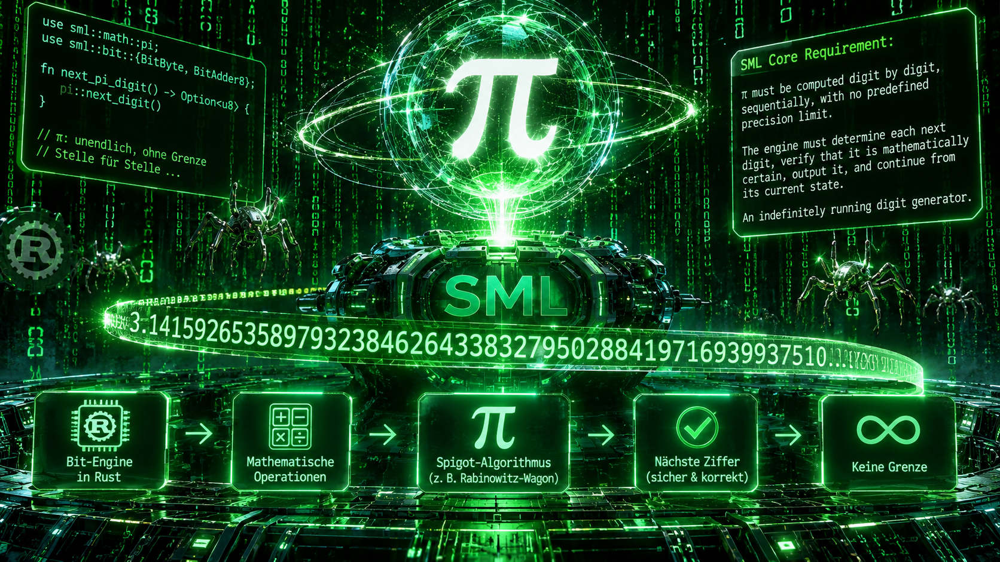

# π Bit Engine

**Computing π from the ground up using bitwise operations in Rust.**

A low-level Rust project exploring how mathematical computation can be built from fundamental bit operations — without relying on conventional arithmetic as the computational foundation.

## Vision

- Build a bitwise arithmetic engine from the ground up.
- Develop mathematical operations using bit-level primitives.
- Explore algorithms for computing π.
- Visualize binary operations, registers, carries and computational states.
- Keep the engine modular, testable and transparent.

## Current Status

**Phase 1 — Bit Core**

- `BitByte` abstraction
- AND, OR, XOR, NOT
- Left and right shifts
- Set, clear, toggle and check individual bits
- Validated bit indices with explicit error handling
- Unit tests and Clippy checks

## Built With

- Rust
- Cargo
- Linux
- Test-driven development

## Philosophy

No shortcuts. No black boxes.

Every operation is built, tested and understood at the bit level.

**π is the goal. Bits are the foundation.**

## Core Requirement

π must be computed digit by digit, sequentially, with no predefined precision limit.

The engine must determine each next digit, verify that it is mathematically certain, output it, and continue from its current state — without recalculating previous digits or computing a fixed number of digits in advance.

The goal is an indefinitely running digit generator, limited only by available computational resources.
